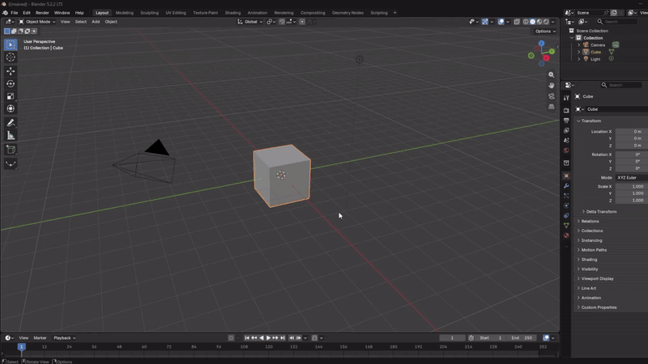
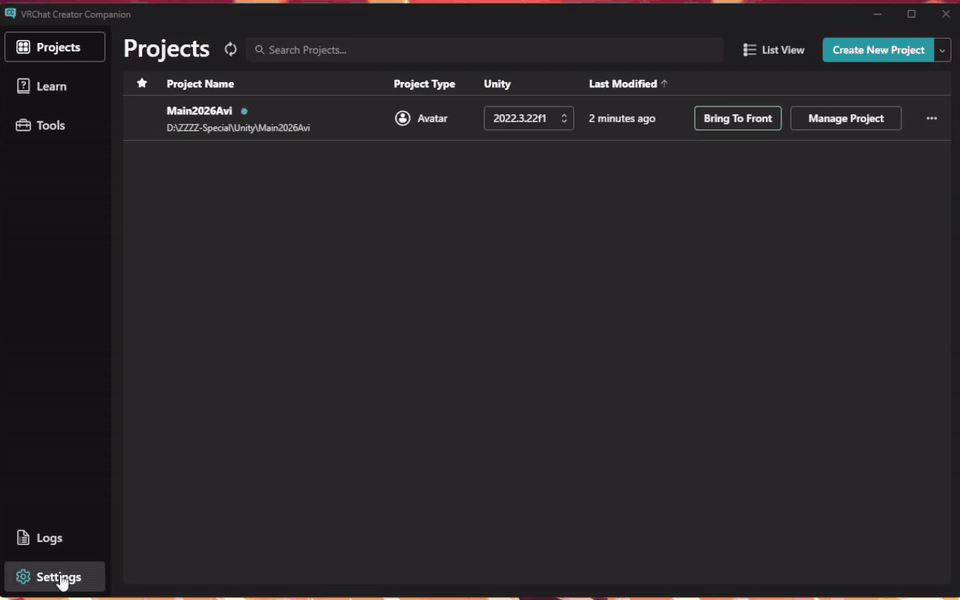
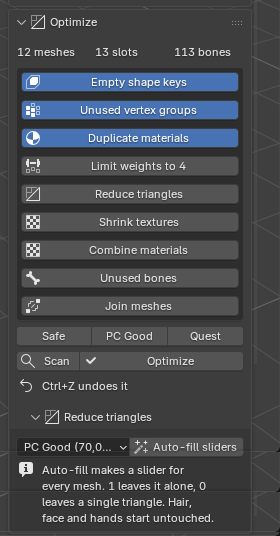
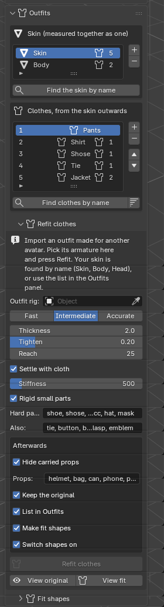

# THIS IS STILL IN THE DEVELOPMENT PHASE!
## PLEASE USE ON A THROWAWAY PROJECT AND DO NOT RELY ON IT HEAVILY!

# KAT: Krislyz's Avatar Tools

KAT is a Blender plugin & Unity utility designed to make your process of creating avatars and worlds for VRChat better, and easier, alongside a few Blender QoL additions.

Made for Blender 5.0 and newer. Tested on 5.0, 5.1 and 5.2.

**Download:** [KAT releases](https://github.com/Krislyz/KAT-Tools/releases) · **Website:** [krislyz.com/kat](https://krislyz.com/kat/)

## Features

- Import any model file, with the textures found and shown. Missing ones are looked for by themselves when a .blend opens
- Fix and clean with options you tick: bone naming, T-pose, pose mode, save as rest pose
- Visemes, blinking and eye bones, and VRChat face tracking shapes
- Refit: put clothes made for another avatar on yours. Skeleton, surface, weights and binding in one press, and layers that do not overlap
- Merge two armatures: bones that match become one, with options for what happens to the rest
- Anti-clip shape keys, so layered clothes do not poke through each other or the skin
- One-click optimization: Safe, PC Good and Quest presets, bone merging, join and weld
- Atlas many meshes at once, with normal maps, emission and cut-out alpha
- Reduce triangles with one slider per mesh. Hair, face and hands stay put
- Shrink big textures without touching the files
- Worlds and props: collision, LODs, lightmap UVs, prop generators, export for Unity
- Check against the VRChat PC and Quest ranks
- Version history of what you import and export, with the textures
- A Unity package that picks all of it up (VCC and ALCOM), and a right-click **Send to Blender** that hands the materials and textures over

## Requirements

- Blender 5.0 or newer
- Nothing else. KAT only uses what Blender ships with, so there is nothing to install next to it
- For the Unity part: Unity 2022.3, and the VRChat SDK for the avatar and world helpers

## Install in Blender

1. Download `katt-blender-plugin-v0.3.2.zip` from the [releases](https://github.com/Krislyz/KAT-Tools/releases).
   **Do not extract it.** Blender wants the zip.
2. In Blender open **Edit > Preferences > Get Extensions**.
3. Open the small arrow at the top right and pick **Install from Disk...**
4. Choose the zip and press **Install from Disk**. Leave **Enable on Install** ticked.
5. In the 3D view press **N**. There is a new **KAT** tab on the right.

To update, remove the old KAT in **Get Extensions**, restart Blender, and install the new zip the same way.

## Install in Unity

KAT's Unity package comes through VPM, so VCC and ALCOM both take it.

1. Open the [KAT page](https://krislyz.com/kat/) and press **Add to VCC / ALCOM**.
   Or add this URL by hand under **Add Repository**: `https://cdn.krislyz.com/vpm/index.json`
2. Add **KAT Unity Utilities** to your project.

Export from Blender with **Export for Unity**. The file window has options on the right: copy the textures the materials use (all of them, or only those that are not in your Unity project yet) into a folder you pick, apply modifiers, triangulate, embed the textures in the FBX, leaf bones, smoothing, and whether to write the `.kat.json`. Next to the FBX it writes a small `.kat.json` file, and the package reads it to set up the humanoid, the materials, the outfit toggles and the VRChat avatar.

The other way: right-click a model file, a prefab or an object in the scene and pick **KAT > Send to Blender**. The rest of KAT's Unity side lives in one panel: **KAT > KAT Panel**, with tabs for Avatar, Sync, Optimize, World and Settings. It writes a `.kat-unity.json` next to the model with the texture each material really uses and whether it is opaque, cutout or transparent. Import the model in Blender and its materials point at the same files. For a model that is already open, press **Sync textures from Unity** in Optimize > Textures. Nothing is written until you ask.

## The panels

Everything sits in the **KAT** tab, from top to bottom. The main panels are closed until you open them. The smaller panels inside them are open.

The panels follow the order you work in.

| Panel | What it does |
| --- | --- |
| Quick access | Import, export and the state of the model |
| Fix & clean | The repairs you tick, bone naming, translate |
| Pose | Pose mode, T-pose, save as rest pose |
| Custom avatar | Merge armatures (matching bones become one), attach meshes |
| Face | Pick the face mesh. Inside: Visemes, Blink & Eyes, Face tracking |
| Outfits | The skin and the clothes, in layers. Inside: Refit clothes, Fit shapes |
| Optimize | The one-click checklist. Inside: Join & weld, Materials & atlas, Textures (find missing, sync from Unity), Reduce triangles, Bone merging (merge to parent, roots for loose bones) |
| Check | The VRChat rank for PC or Quest |
| World | Scan, combine, collision, LODs, lightmap UVs. Inside: Props |
| Version history | Every import and export, restorable |
| Settings, Credits | Options, links |

### Reduce triangles

Press **Auto-fill sliders** and pick a goal. KAT tries cuts on every mesh and measures how far the surface moves, then fills the sliders. Hair, face and hands are never touched, and you can protect any other mesh. Drag a slider to change a mesh. With **Real-time preview** ticked the viewport shows the result while you drag, and nothing changes until you press **Reduce**.

Shape keys, weights, UVs, materials and custom normals come along. Ctrl+Z undoes it.

 

### Refit clothes

For an outfit made for another avatar. Import it, pick its armature in **Refit clothes**, put your skin in the Outfits panel (or let KAT find it by name: Skin, Body, Head) and press **Refit**. Pick a **Mode** first. Intermediate takes about a minute for an outfit. Fast is for a first look: coarser, no cloth step. Accurate cuts the cloth much finer, runs many more rounds, checks every garment and uses the thorough set of poses for the fit shapes, and takes several times longer. Ctrl+Z undoes all of it.

- **Skeleton.** The outfit's bones are matched to yours, so limb length, torso length and shoulder width are yours. The outfit's bone weights are smoothed over the cloth first, so shoulders, sleeves and collars bend as one sheet instead of creasing.
- **Surface.** The garment is first laid over your body in one smooth movement, then what is still inside the skin is pushed out, tight cloth that floats off it is drawn on, and loose cloth is left loose. Folds, seams, lapels and hems keep the shape they were designed in. The result is read for ragged edges and flipped faces, and mended. The shading follows the fitted shape.
- **Layers.** Every garment is stopped by the ones under it the way the skin stops it, so a jacket does not sit inside a shirt. What was tucked in (a shirt hem in trousers) stays tucked in.
- **Hard parts.** Shoes, helmets, bags, ties, buckles and badges keep their shape and move as one piece. A belt or a cuff that is a piece of its own rides along with the cloth under it.
- **Cloth.** Last, Blender's own cloth settles each garment on the body. It is stiff and held to the shape it has, so a suit keeps its look. It only moves cloth that lies on the skin, it never pushes cloth into the body, and if a result comes out torn it is thrown away. Turn it off or change **Stiffness** in the panel.
- **Weights.** The outfit's weights move onto your bones and are blended with the body's where the cloth lies on the skin.

Each garment keeps the shape it had before the fit as a shape key called `KAT.original`. **View original** and **View fit** under the Refit button switch between the two, so a fit is never a one way trip. Untick **Keep the original** if you do not want the key.

Afterwards it can do the rest for you, and each step can be switched off: hide carried props (a helmet in hand), list the clothes in the Outfits panel in layer order, make the fit shapes, and switch them on.

Tested on a few outfits (a suit, a racing outfit, a dress with accessories) and one body. Shapes that are hard and sit on a joint, like knee pads, can still clip a little in a deep squat. If an outfit comes out wrong, please open an issue and say what it was.

 

### Outfits

List the skin first (head and body can be separate meshes), then the clothes from the skin outwards. **Create fit shapes** puts the avatar through about 30 poses and writes `KAT.fit.<name>` shape keys. They move the skin in under the clothes, or the clothes out, only where something clips. Everything is measured from the basis shape, and nothing else on the mesh is touched.

Switch the keys on when both pieces are worn. The Unity package turns them on for you when the outfits are toggled.

## Good to know

- Quest limits are strict. Hair, face and hands are never reduced, so some avatars cannot reach Quest Good with triangles alone. KAT says so instead of cutting them.
- The Unity side has been tested in a throwaway project, not in a full avatar project yet.
- Close Blender before you replace an installed copy, or it keeps running the old one.

## Report a problem

Open an [issue](https://github.com/Krislyz/KAT-Tools/issues). Say which Blender version you use and what you pressed. Security problems go through the private advisory link on the issue page.

## License

KAT is licensed under **GPL-3.0-only**, see [LICENSE](LICENSE). Copyright (C) 2026 Krislyz.

KAT was made to make your avatar workflow easier.
